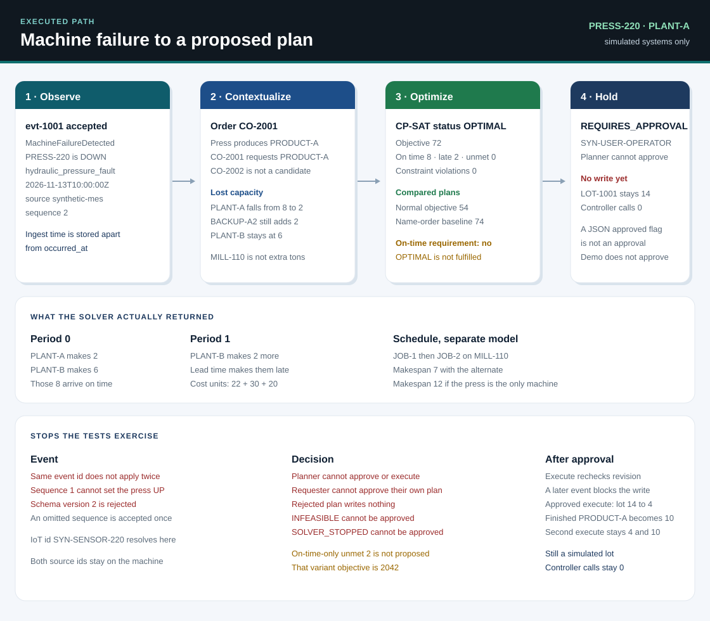
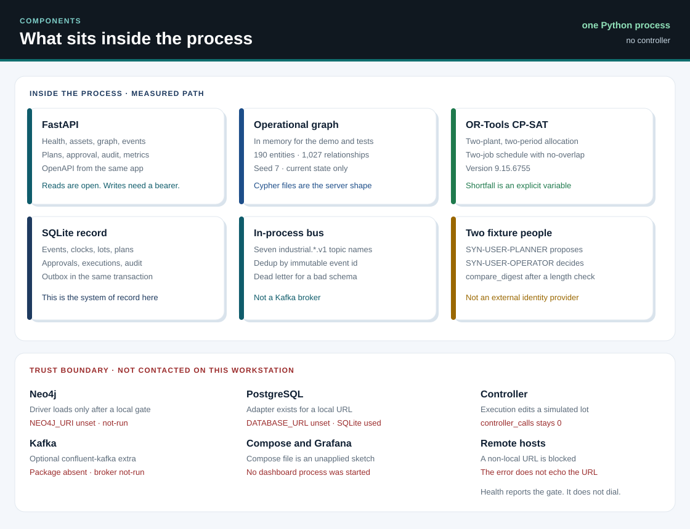
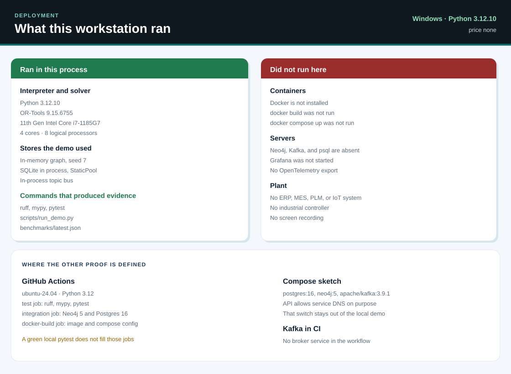

# Industrial AI Knowledge Graph Optimizer

Self-directed simulation of a manufacturing disruption. A machine fails, a graph names the customer order that depends on it, a constraint solver proposes a new allocation, and nothing is written until a different person approves. The approved write changes a simulated inventory lot. No plant, ERP, MES, or controller is contacted.

This is a reference project. It is not an employer product, a customer deployment, or a claim that a factory ran this software.



## What problem this solves

At 10:00, press PRESS-220 at PLANT-A is down with a hydraulic pressure fault. Customer order CO-2001 still wants 10 units of PRODUCT-A. The useful output is a feasible allocation, or an explicit shortage, with the constraints named, and a hold for a person before any simulated stock move.

The path the code runs is:

Observe, contextualize, optimize, validate, approve, then execute on the simulated lot.

Forecasting is present as an advisory signal. It does not decide feasibility. There is no language model in the decision path.

## Why a graph

The allocation model does not discover the plant on its own. The graph does.

PRESS-220 produces PRODUCT-A. CO-2001 requests PRODUCT-A. CO-2002 requests PRODUCT-B, so it is not a candidate for this failure. SEAL-KIT-220 is the material on the PRODUCT-A bill of materials, one per unit. SUP-001 supplies that material. ROUTE-01 connects the shipment to WH-NORTH with lead time 1 and capacity 20.

The seeded catalog, random seed 7, holds 190 entities and 1,027 relationships: 3 factories, 8 suppliers, 3 warehouses, 20 machines, 25 products, and 50 customer orders. That catalog is structural. The hand scenario below is the case a person can recompute without the solver.

A failure adds MaintenanceEvent FAIL-001, which affects PRESS-220. PRESS-220 contributes 6 of PLANT-A's 8 units of PRODUCT-A capacity. BACKUP-A2 still contributes 2. PLANT-B stays at 6. PLANT-C contributes 0 and is omitted from the decision vector. MILL-110 can take the two-job schedule. It does not add PRODUCT-A allocation capacity.

MES identifier PRESS-220 and IoT identifier SYN-SENSOR-220 resolve to the same machine. Both source identifiers stay on the node.

The graph holds relationships and a current-state projection. SQLite holds the events, inventory lots, plans, approvals, and audit rows. Detailed telemetry is not copied into the graph. A vibration spike of 95 is an advisory anomaly. It does not change machine state.

## Why a solver

A traversal can list CO-2001. It cannot decide how many units to make at each plant, in which period, without going negative on materials or over a route cap. A language model is not in this repository and would not be a proof of those constraints.

The allocation model is Google OR-Tools CP-SAT. Shortfall is a variable, so the solver can return OPTIMAL while the customer is still short or late. The application keeps those facts apart. `operational_requirement_met` is true only when unmet demand is 0 and late units are 0.

On the failure scenario the solver returns OPTIMAL, objective 72, 8 on time, 2 late, 0 unmet, and 0 constraint violations. The on-time requirement is not met. The decision status is REQUIRES_APPROVAL.

The same snapshot with late shipments forbidden is a different solve: unmet 2, objective 2042. The demo prints that variant and does not propose it.

A separate CP-SAT model schedules JOB-1 (duration 4) then JOB-2 (duration 3). With PRESS-220 down from time 0 through 5 and MILL-110 available, both jobs move to MILL-110 and the makespan stays 7. Without the alternate, both stay on the press, JOB-1 starts at or after 5, and the makespan is 12. That schedule is the execution sequence. It is not a second copy of the allocation quantities.

Coefficients, the hand arithmetic, and the starter model are in [docs/optimization-model.md](docs/optimization-model.md). The starter's "machine failure" reduces plant B. PRESS-220 is plant A in the two-period model. Those two checks stay separate.

## How a failure becomes a plan

`scripts/run_demo.py` runs the machine-failure scenario and refuses to print if the numbers drift from the hand calculation. It does not approve the plan. The transcript from this workstation:

```
Industrial AI Operational Optimization Demo
-------------------------------------------
Scenario: Machine Failure
Factory: PLANT-A
Asset: PRESS-220

1. Event received and validated
2. Operational graph updated
3. Affected customer orders identified: CO-2001
4. Optimization snapshot created
5. Revised production plan computed
6. Capacity and material constraints checked
7. Proposed plan awaiting operator approval

Result:
  Decision status: REQUIRES_APPROVAL
  Solver status: OPTIMAL
  Constraint violations: 0
  Unmet demand: 0
  Late: 2
  On time: 8
  Objective: 72
  Normal objective: 54
  Name-order baseline objective: 74
  Operational requirement met: no
  On-time-only unmet demand, not proposed: 2

Execution:
  No operational action performed before approval
  Simulated systems only
  Inventory lot LOT-1001 remains 14
  Controller calls: 0
```

The normal plan meets the on-time requirement at objective 54. The name-order baseline on the failed press costs more (objective 74) and does not fulfill more demand. The solver's production cost and objective are both lower.

Other scenarios, same solver, same coefficients:

| Scenario | Solver status | On time | Late | Unmet | Objective |
| --- | --- | --- | --- | --- | --- |
| Normal operations | OPTIMAL | 10 | 0 | 0 | 54 |
| PRESS-220 down, late allowed | OPTIMAL | 8 | 2 | 0 | 72 |
| PRESS-220 down, on time only | OPTIMAL | 8 | 0 | 2 | 2042 |
| Supplier delay, 4 materials | OPTIMAL | 4 | 0 | 6 | 6020 |
| Demand surge to 20 | OPTIMAL | 14 | 0 | 6 | 6078 |
| Shortage forbidden, late forbidden, 4 materials | INFEASIBLE | | | | |

The empty cells are the infeasible model: it returns no allocation. That plan cannot be approved.

Event contracts and the in-process bus are in [docs/event-contracts.md](docs/event-contracts.md). Kafka topic names are used. A Kafka broker was not started on this workstation.

## How risk is controlled

- The planner identity SYN-USER-PLANNER can reset, ingest, and solve. It cannot approve or execute.
- The operator identity SYN-USER-OPERATOR can approve, reject, and execute. The approver must be a different person from the requester.
- Fixture tokens are `lab-planner` and `lab-operator`. Comparison uses `secrets.compare_digest` after a length check. This is not an external identity provider. A JSON field named `approved` is not an approval.
- Approval alone leaves LOT-1001 at 14. Execute is a separate call.
- Execute rechecks the snapshot revision. A later accepted event makes the plan stale and the write is refused.
- A repeated execute returns the first effect. The lot stays at 4 and finished PRODUCT-A stays at 10.
- A rejected plan cannot execute. An INFEASIBLE plan and a SOLVER_STOPPED plan cannot be approved.
- Duplicate `event_id` values do not change state again. A stale sequence cannot set the press back to UP. Schema version 2 is rejected.
- `occurred_at` and the ingestion time are stored separately. The tests pin ingestion at 2026-11-12T15:00:00Z.
- The outbox row is written in the same SQLite transaction as the accepted event. If publication fails, recovery publishes once and does not apply the event again.
- If the graph projection fails after the store commit, reconcile copies entity state and the lot from SQLite back onto the graph.
- The in-process lock is not a distributed lock.
- `controller_calls` stays 0. The flow test patches socket creation and expects no connection.
- Health reports adapter gates. It does not dial Neo4j, Kafka, or PostgreSQL.

The threat model is [docs/threat-model.md](docs/threat-model.md). Runbooks are under [docs/runbooks](docs/runbooks).

## Evidence

Hardware for `benchmarks/latest.json`: 11th Gen Intel(R) Core(TM) i7-1185G7 @ 3.00GHz, 4 cores, 8 logical processors, Python 3.12.10, OR-Tools 9.15.6755, Windows. Price: none.

The timer is ingest plus solve on the hand scenario after reset, 40 repeats, solver time limit 5.0 seconds. The event-to-plan nearest-rank p95 was 0.032483 seconds. The acceptance bar of 2 seconds was met for this small scenario. It is not a result at 10,000 orders.

Solver wall time on those repeats: minimum 0.006555 seconds, median 0.009827 seconds, maximum 0.019853 seconds. The 5 second limit did not stop the solver. A test that forces solver status UNKNOWN checks the SOLVER_STOPPED policy. That test is not a measured timeout.

The in-memory impact walk for PRESS-220, 100 samples, had a p95 of about 1.1 microseconds. That is a Python walk over the seeded graph. It is not a Neo4j measurement.

One approve, one execute, and one replay left `invalid_executed_plans` at 0 on that run.

A separate in-memory scale graph built 17,000 entities and 110,000 relationships in 0.178 seconds and answered one impact query in 0.000071 seconds. It was not loaded into Neo4j. Full samples are in [benchmarks/latest.json](benchmarks/latest.json). The method is in [docs/benchmarks.md](docs/benchmarks.md).

Local quality commands on this tree, before publication: ruff clean, mypy clean on the `industrial_ai` package, pytest 35 passed and 2 skipped. The skips are `tests/integration/test_live_adapters.py` because `NEO4J_URI` and `DATABASE_URL` were unset. Those commands do not start Docker.

On commit `d668970`, GitHub Actions run [43367549006](https://github.com/JatinF/industrial-ai-knowledge-graph-optimizer/actions/runs/43367549006) succeeded. The jobs were test (check run 131695413138), docker-build (check run 131695413520), and integration (check run 131695413614). Security run [43367548902](https://github.com/JatinF/industrial-ai-knowledge-graph-optimizer/actions/runs/43367548902) succeeded. The scan job was check run 131695413124. Annotation lists for those four check runs returned `[]`.

The integration job contacted Neo4j 5 and PostgreSQL 16 on that runner. This workstation did not. Docker is not installed here, so the local image build stayed not-run. The image proof is the Actions `docker-build` job. A green local pytest does not replace that job.

There is no screen recording. The transcript above is the demonstration.





## Run it on a workstation

Python 3.12 or newer. The measured path does not need Docker, Neo4j, Kafka, or PostgreSQL.

```bash
git clone https://github.com/JatinF/industrial-ai-knowledge-graph-optimizer
cd industrial-ai-knowledge-graph-optimizer
python -m venv .venv
```

Windows, from the repository directory:

```powershell
.\.venv\Scripts\python -m pip install -e ".[dev]"
.\.venv\Scripts\python scripts\run_demo.py
.\.venv\Scripts\python -m pytest
.\.venv\Scripts\python -m ruff check src tests scripts
.\.venv\Scripts\python -m mypy
.\.venv\Scripts\python scripts\benchmark.py
```

`make seed`, `make demo`, `make test`, and `make benchmark` call the same scripts. `make seed` writes the CSV files and `graph/seed.cypher`. It prints the Neo4j gate and does not open a connection when `NEO4J_URI` is unset.

Copy `.env.example` to `.env` only if you intend to leave the values empty or point them at localhost. An unset URL is not contacted. Any other host is blocked unless `INDUSTRIAL_AI_ALLOW_REMOTE=1`. That switch is set in `docker-compose.yml` so the API container can use service DNS. Do not set it for the workstation demo. A blocked call does not include the URL in the error.

`docker compose up` is the composed sketch. Docker is not installed on the workstation that produced the numbers above, so compose was not started here. Image proof is the Actions `docker-build` job after it is green. Details are in [docs/deployment.md](docs/deployment.md).

## API

| Method | Path | Who |
| --- | --- | --- |
| GET | `/health` | open |
| GET | `/metrics` | open, Prometheus text, no exporter |
| GET | `/api/v1/assets` | open |
| GET | `/api/v1/graph/dependencies/{asset_id}` | open |
| GET | `/api/v1/graph/impact/{asset_id}` | open |
| GET | `/api/v1/plans/{plan_id}` | open |
| GET | `/api/v1/audit/events` | open |
| POST | `/api/v1/scenarios/reset` | planner |
| POST | `/api/v1/scenarios/{id}/run` | planner |
| POST | `/api/v1/events` | planner |
| POST | `/api/v1/plans/solve` | planner |
| POST | `/api/v1/plans/{plan_id}/approve` | operator, other person |
| POST | `/api/v1/plans/{plan_id}/reject` | operator |
| POST | `/api/v1/plans/{plan_id}/execute` | operator |

A plan response includes the snapshot revision, solver status, objective, unmet demand, late units, on-time units, productions, shipments, constraint violations, explanation, candidate orders, the schedule, the baseline, advisory signals, and a trace id. The explanation is a deterministic string.

## Layout

`src/industrial_ai` is split by responsibility: API, domain, ingestion, graph, optimization, streaming, execution, storage, telemetry, and a small advisory `ml` package. `graph/` holds Cypher constraints, the generated seed, and parameterized queries. `datasets/` holds the synthetic CSVs and the five scenario files. `db/migrations/001_operational.sql` documents the SQLite table set. The store still creates tables through SQLAlchemy.

## Limitations

- Simulation only. No industrial deployment is claimed.
- The allocation that the tests lock is two plants, two periods, one finished good, and one constraining material. Wider bill-of-materials edges exist for other products. They are not decision variables in that model.
- The schedule is two jobs and at most two machines.
- The seeded catalog is not itself the hand optimum. Extra machines do not produce PRODUCT-A.
- Stretch sizes in the original design notes, including 10,000 orders, were not solved. The 17,000-entity figure is an in-memory build.
- Neo4j, Kafka, and PostgreSQL were not contacted here. The Cypher files and the SQL migration are the shapes those adapters use when a local URL is set.
- `graph/queries/production_dependencies.cypher` filters on `$product_id`. The in-memory helper returns the full list. Both behaviors are documented in [docs/ontology.md](docs/ontology.md).
- scikit-learn is not installed. The forecast is ordinary least squares in pure Python. The next point of 10, 12, 14, 16 is 18. That number is not a capacity.
- Grafana and OpenTelemetry export were not run. `/metrics` is generated text.
- The in-process lock is not a distributed lock.
- PRESS-220 and SEAL-KIT-220 also appear as synthetic identifiers in the public repository `industrial-ai-solutions-architecture`. This repository does not import that package.
- Gremlin and JanusGraph are not implemented.
- There is no screen recording.
- This repository was written in a Grok Build session. The note is [docs/ai-sdlc.md](docs/ai-sdlc.md).

## License

MIT. Copyright 2026 Jatinder Singh. See [LICENSE](LICENSE).
