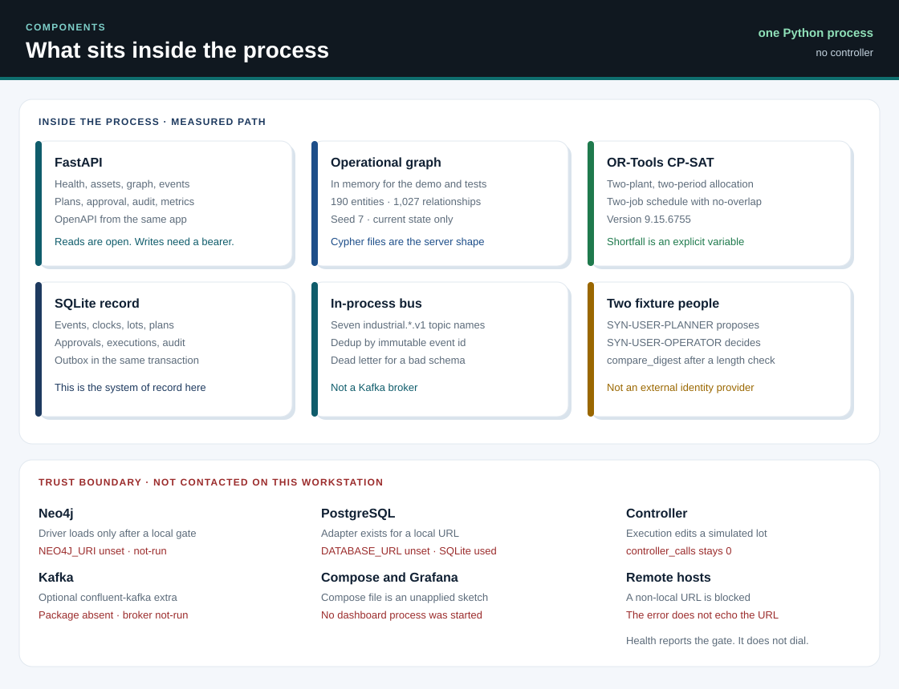
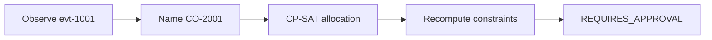

# Architecture

The measured system is one Python 3.12 process. It keeps an operational graph in memory, authoritative rows in SQLite, and decisions in OR-Tools CP-SAT. FastAPI exposes the same process. Neo4j, Kafka, and PostgreSQL adapters exist and stay closed until a URL passes the local-host gate.

## Flow

The demo stops at the hold. An approved execute is a later call, and the demo does not make it.

## Responsibilities

| Piece | Role on the measured path |
| --- | --- |
| `graph/repository.py` | Nodes, edges, aliases. Ids are unique per label. |
| `graph/impact_analysis.py` | Candidate orders and lost capacity from current edges. |
| `optimization/allocation_solver.py` | Two-period CP-SAT model. |
| `optimization/scheduling_solver.py` | Two-job intervals, precedence, downtime, no-overlap. |
| `optimization/feasibility.py` | Independent check of the returned point. |
| `optimization/greedy.py` | Name-order baseline. Not the proposed plan. |
| `storage/relational.py` | SQLite events, clocks, lots, plans, approvals, audit, outbox. |
| `streaming/` | In-process bus using the Kafka topic names. |
| `execution/` | Role check, revision check, one simulated inventory write. |
| `ml/` | Advisory forecast and threshold. Ignored by feasibility. |
| `storage/neo4j.py` | Used only after the gate returns local or remote. |
| `streaming/kafka_gateway.py` | Producer constructed only after the gate and a successful import. |

## Snapshot rule

The solver reads one snapshot: revision, plant capacities, material pool, route capacity, demand, and the down machines. Execute later compares that revision with the store. A newer accepted event bumps the revision, and the approved plan cannot write.

Graph updates happen after the store commit. A forced projection error leaves the store correct. `reconcile()` copies entity state and the lot back onto the graph.

## What the first release covers

The first working slice is the foundation, the ontology, the impact query, the allocation model, and one tested disruption-to-plan path. The two-job scheduler, the in-process bus, and the approval workflow are in that same tree. They are smaller than a plant scheduler or a broker deployment.

| Slice | State in this repository |
| --- | --- |
| Package, FastAPI, SQLite, CI workflow file | Present. Compose was not started here. |
| Ontology, seed, uniqueness | Present in memory and as Cypher. |
| Impact and dependency queries | Present. Live Neo4j was not contacted here. |
| Allocation solver and fixtures | Present and locked by tests. |
| Two-job scheduler | Present. Not a plant-wide schedule. |
| Streaming | In-process bus, idempotency, outbox. Broker not-run. |
| Replanning on three disruptions | Machine, supplier, and demand scenarios. |
| Human approval and simulated execute | Present. No controller. |
| Predictive signals | Advisory only. |
| Benchmarks and runbooks | One workstation JSON file and these docs. Grafana not-run. |

## Extension that is not in this version

A Gremlin or JanusGraph adapter is a later extension. The running graph is the in-memory repository, with Neo4j as the server that the Cypher files target when a local bolt URL is configured.
